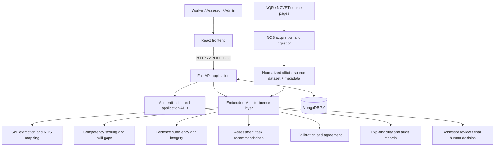

# KaushalTwin — Evidence-Grounded Recognition of Prior Learning


> **“The RPL system that knows when it doesn't know.”**

**KaushalTwin** is an AI-assisted Recognition of Prior Learning (RPL) platform that helps skilled workers demonstrate competencies gained through informal work experience. It organizes worker claims and assessment evidence into structured, explainable competency assessments that support qualified human assessors.

> [!IMPORTANT]
> **AI assists; it does not certify.** Skill matches, scores, sufficiency checks and certification recommendations are decision-support outputs. A human assessor retains responsibility for the final certification decision. The evaluation fixtures currently include synthetic examples awaiting empirical validation.

---

## Contents

- [Overview](#-overview)
- [🧭 Core principles](#-core-principles)
- [🧩 Capabilities](#-capabilities)
- [🏗️ Architecture](#️-architecture)
- [🗂️ Repository structure](#️-repository-structure)
- [🧰 Technology stack](#-technology-stack)
- [🚀 Quick start — Docker Compose](#-quick-start--docker-compose)
- [🛠️ Run without Docker](#️-run-without-docker)
- [🔐 Demo accounts](#-demo-accounts)
- [🧠 ML modules](#-ml-modules)
- [🔌 API reference](#-api-reference)
- [🇮🇳 Official NOS data and provenance](#-official-nos-data-and-provenance)
- [🧪 Testing and evaluation](#-testing-and-evaluation)
- [⚙️ Configuration](#️-configuration)
- [🧯 Troubleshooting](#-troubleshooting)
- [🛡️ Security and production readiness](#️-security-and-production-readiness)
- [🗺️ Roadmap](#️-roadmap)
- [📚 References](#-references)

---

## ✨ Overview

Recognition of Prior Learning enables people to have skills gained outside formal education assessed and recognised. KaushalTwin aims to support that process by connecting worker experience, evidence, occupational standards and assessor review in one workflow.

### The workflow

1. **Capture experience** — collect a worker's experience descriptions and relevant evidence.
2. **Extract candidate skills** — identify skill claims from text, including Hindi, English and Hinglish inputs where supported.
3. **Map to occupational standards** — retrieve possible National Occupational Standards (NOS) matches from the available dataset.
4. **Build a competency view** — summarize evidence coverage, competency scores and gaps.
5. **Guide assessment** — suggest useful next tasks and flag missing, conflicting or insufficient evidence.
6. **Review transparently** — provide explanations, provenance and recommendations for human review.
7. **Record the human decision** — the assessor, not the AI, makes the final certification decision.

### What this project is — and is not

| ✅ It is | ⚠️ It is not |
|---|---|
| An RPL workflow and assessor decision-support prototype | An autonomous certification authority |
| An integration of application APIs, ML logic and MongoDB persistence | Proof that every supported trade has been comprehensively covered |
| A place to inspect evidence, skill mappings and explainable recommendations | A substitute for verified practical assessment |
| A codebase with tests and synthetic evaluation fixtures | A claim of field-validated accuracy, fairness or calibration |

---

## 🧭 Core principles

- **Evidence before confidence.** Recommendations should be grounded in available evidence and its provenance.
- **Abstention is an outcome.** When evidence is insufficient, conflicting or outside the system's ability to judge, the system can recommend more evidence or human review.
- **Scores are not proof.** Competency scores, evidence coverage and evidence confidence represent different concepts and must not be conflated.
- **Explainable decision support.** Recommendations should carry reasons that an assessor can inspect.
- **Human authority.** AI never makes the final assessor decision and never independently awards certification.
- **Clear data provenance.** Official source-derived records, demo records and synthetic evaluation examples are distinct data categories.

---

## 🧩 Capabilities

| Capability | Purpose |
|---|---|
| **Skill extraction** | Extract candidate skills from worker descriptions/transcripts. |
| **NOS mapping and search** | Match candidate skills to available occupational-standard records. |
| **Competency Twin** | Represent competency status using scores and observed evidence coverage. |
| **Evidence integrity analysis** | Analyze evidence metadata, detect duplicates and surface potential conflicts. |
| **Adaptive assessment** | Rank assessment tasks using a deterministic, explainable task-value approach where implemented. |
| **Skill-gap analysis** | Highlight competency gaps, missing evidence and evidence debt. |
| **Evidence sufficiency and abstention** | Recommend whether evidence may be ready for assessor review, needs more evidence, or requires abstention/conflict review. |
| **Assessor calibration** | Compare scoring patterns and agreement between assessors. |
| **Certification recommendations** | Generate advisory recommendations for human review, not certificates. |
| **Explainability and audit support** | Track claim provenance, create integrity-checkable audit records and compile decision reports. |
| **Official NOS ingestion** | Acquire and normalize a limited sample of NQR-derived NOS records with accompanying metadata. |
| **Evaluation tooling** | Evaluate metrics, calibration, assessor agreement and fairness-related questions; empirical validation is still required. |

---

## 🏗️ Architecture



### Services and ports

| Component | Responsibility | Local URL |
|---|---|---|
| **Frontend** | React UI for application workflows | `http://localhost:3000` (Docker) or Vite's displayed URL (manual setup) |
| **Backend** | FastAPI application, auth, persistence and embedded ML API | `http://localhost:8000` |
| **Swagger UI** | Interactive backend API documentation | `http://localhost:8000/docs` |
| **ReDoc** | Alternative API documentation | `http://localhost:8000/redoc` |
| **Liveness check** | Basic backend health endpoint | `http://localhost:8000/health` |
| **MongoDB** | Persistence for users, workers, assessments, evidence and related records | `mongodb://127.0.0.1:27017` from host processes |

> [!NOTE]
> The ML intelligence layer lives inside `backend/ml/` and is imported by the main backend. It is **not a separate Compose service** in the current local setup.

---

## 🗂️ Repository structure

The following is a high-level guide to the current project layout. Confirm exact filenames in the repository when extending the code.

```text
KaushalTwin/
├── backend/
│   ├── app/
│   │   ├── api/v1/                 # Application API routes
│   │   ├── core/                   # Configuration and security
│   │   ├── db/                     # MongoDB connectivity and models
│   │   └── main.py                 # FastAPI entry point
│   ├── ml/
│   │   ├── api/                    # Embedded ML routers
│   │   ├── data/
│   │   │   ├── official_nos.json   # Normalized NQR-derived records
│   │   │   ├── raw/nqr/            # Raw source snapshots (kept local/ignored)
│   │   │   └── evaluation_ground_truth.json
│   │   ├── evaluation/             # Metrics, calibration, agreement, fairness
│   │   ├── ingestion/              # NOS acquisition and normalization
│   │   ├── schemas/                # ML API schemas
│   │   ├── services/               # ML service logic
│   │   └── nos_repository.py       # NOS data access/selection
│   ├── tests/                      # Backend tests
│   ├── Dockerfile
│   ├── requirements.txt
│   └── seed_demo_data.py           # Local demo data seeder
├── frontend/
│   ├── src/
│   │   ├── api/                    # API client modules
│   │   ├── components/             # Shared UI components
│   │   └── pages/                  # Application pages
│   ├── Dockerfile
│   ├── nginx.conf                  # Docker frontend and API proxy
│   └── package.json
├── docker-compose.yml
├── .gitignore
└── README.md
```

---

## 🧰 Technology stack

| Layer | Technologies |
|---|---|
| Backend API | Python 3.11, FastAPI, Uvicorn, Pydantic |
| Application persistence | MongoDB 7.0, Motor/PyMongo drivers |
| ML and data processing | NumPy, pandas, scikit-learn and project-specific deterministic algorithms |
| NOS ingestion | Python ingestion/acquisition pipeline, JSON data and provenance metadata |
| Frontend | React, Vite, JavaScript/JSX and the dependencies declared by `frontend/package.json` |
| API validation and tests | Pytest; frontend test tooling as configured in `frontend/package.json` |
| Local orchestration | Docker Desktop and Docker Compose |

Optional providers or model libraries may require additional installation, downloads or credentials. The default local Compose settings use demo providers, not an externally hosted or empirically validated production model.

---

## 🚀 Quick start — Docker Compose

**Recommended for the most consistent local setup.** Docker Compose runs MongoDB, the backend and the frontend together.

### Prerequisites

- Git
- Docker Desktop with Docker Compose support
- Docker Desktop running before you execute the commands

### 1. Clone the repository

```powershell
git clone https://github.com/Pritosh2387/KaushalTwin.git
cd KaushalTwin
```

If you already have the repository, open PowerShell and change to your existing project directory instead.

### 2. Create a local `.env` file

The Compose configuration requires `JWT_SECRET_KEY`. Generate a random local secret without printing it:

```powershell
$bytes = New-Object byte[] 48
$rng = [System.Security.Cryptography.RandomNumberGenerator]::Create()
$rng.GetBytes($bytes)
$secret = [Convert]::ToBase64String($bytes).TrimEnd('=').Replace('+','-').Replace('/','_')
$rng.Dispose()

Set-Content -Path .env -Value "JWT_SECRET_KEY=$secret" -Encoding ascii

$secret = $null
$bytes = $null
Write-Host "Created local .env file."
```

The root `.env` file must remain untracked. Do not commit it or copy a real secret into source code.

### 3. Validate and start all services

```powershell
docker compose config --quiet
docker compose up -d --build
docker compose ps
```

The first build can take several minutes because Docker downloads base images and installs Python/Node dependencies.

### 4. Open the application

- **Frontend:** [http://localhost:3000](http://localhost:3000)
- **Backend Swagger UI:** [http://localhost:8000/docs](http://localhost:8000/docs)
- **Backend ReDoc:** [http://localhost:8000/redoc](http://localhost:8000/redoc)
- **Health check:** [http://localhost:8000/health](http://localhost:8000/health)

### Common Docker commands

```powershell
# Start existing services in the background
docker compose up -d

# Rebuild images after code or dependency changes
docker compose up -d --build

# Show container state and health
docker compose ps

# Inspect backend startup or runtime logs
docker compose logs --tail=100 backend

# Inspect frontend logs
docker compose logs --tail=50 frontend

# Inspect database logs
docker compose logs --tail=50 mongodb

# Follow backend logs live
docker compose logs -f backend

# Stop containers without deleting persisted MongoDB data
docker compose down
```

> [!CAUTION]
> Avoid `docker compose down -v` unless you intentionally want to delete Compose-managed volumes. The `mongodb_data` volume contains your locally persisted database.

---

## 🛠️ Run without Docker

This mode runs the API, frontend and MongoDB as separate local processes. It is useful for debugging and hot reloading. **Docker Desktop is not needed**, but MongoDB must be installed and running locally.

### Prerequisites

- Python 3.11
- Node.js and npm versions compatible with the dependencies in `frontend/package.json`
- MongoDB Community Server 7.0 (or a compatible local MongoDB instance)
- Git

Use the official installation pages for [Python](https://www.python.org/downloads/), [Node.js](https://nodejs.org/en/download/), and [MongoDB Community Server](https://www.mongodb.com/try/download/community).

### 1. Start MongoDB locally

Install MongoDB Community Server and ensure its service is running on port `27017`.

On Windows, if the installer registered a service called `MongoDB`, open PowerShell as an account with service permissions and run:

```powershell
Get-Service MongoDB
Start-Service MongoDB
```

If the service is already running, `Start-Service` is unnecessary. If your MongoDB installation uses another service name, start it using the Windows Services application or the service name configured during installation.

Verify connectivity:

```powershell
mongosh "mongodb://127.0.0.1:27017/kaushaltwin" --quiet --eval "db.runCommand({ ping: 1 })"
```

The response should include `ok: 1`.

### 2. Create a Python environment and install backend dependencies

Open a **PowerShell terminal** at the repository root:

```powershell
cd backend

py -3.11 -m venv .venv
.\.venv\Scripts\Activate.ps1

python -m pip install --upgrade pip
pip install -r requirements.txt
```

If PowerShell blocks virtual-environment activation, use this only for the current terminal session and activate again:

```powershell
Set-ExecutionPolicy -Scope Process -ExecutionPolicy Bypass
.\.venv\Scripts\Activate.ps1
```

### 3. Set backend environment variables

Use the same terminal in which the backend will run. The following values are for local development only:

```powershell
$env:APP_ENV = "development"
$env:MONGODB_URL = "mongodb://127.0.0.1:27017"
$env:MONGODB_DB_NAME = "kaushaltwin"
$env:DEMO_MODE = "false"
$env:DEMO_DATA_ENABLED = "true"
$env:SKILL_EXTRACTION_PROVIDER = "demo"
$env:EMBEDDING_PROVIDER = "demo"
$env:CORS_ALLOWED_ORIGINS = "http://localhost:5173,http://localhost:3000"

$bytes = New-Object byte[] 48
$rng = [System.Security.Cryptography.RandomNumberGenerator]::Create()
$rng.GetBytes($bytes)
$env:JWT_SECRET_KEY = [Convert]::ToBase64String($bytes).TrimEnd('=').Replace('+','-').Replace('/','_')
$rng.Dispose()
$bytes = $null
```

The generated secret exists in this PowerShell session only. If you open another terminal, set the environment variables again or use a properly secured local environment file supported by the application configuration.

### 4. Start the backend

Still in the `backend` directory with the virtual environment activated:

```powershell
python -m uvicorn app.main:app --reload --host 127.0.0.1 --port 8000
```

Keep this terminal running. Check the backend at:

- `http://localhost:8000/health`
- `http://localhost:8000/docs`

The application startup connects to MongoDB. In development/demo-data mode, it attempts to seed initial demo accounts when the `users` collection is empty. Check the terminal logs if initialization fails.

### 5. Install and run the frontend

Open a **second terminal** at the repository root:

```powershell
cd frontend
npm install
npm run dev
```

Use the local URL printed by Vite, typically `http://localhost:5173`.

#### Frontend API routing in manual mode

In Docker, `frontend/nginx.conf` provides the Nginx routing/proxy behavior. When the frontend is launched directly through Vite, Nginx is not running. Inspect the existing API base URL and `frontend/vite.config.*` configuration to ensure frontend API requests reach `http://127.0.0.1:8000`.

If the frontend uses relative `/api/...` requests and the Vite configuration has no API proxy, configure the development server proxy for `/api` to target `http://127.0.0.1:8000`. Keep this as a development-only setting; do not replace or disable the production Nginx proxy.

### 6. Seed demo data manually if needed

Run this from a terminal whose current directory is `backend`, with the same MongoDB and JWT environment variables set:

```powershell
python -c "import asyncio; from seed_demo_data import seed; asyncio.run(seed())"
```

This uses the project's password-hashing function and inserts or updates the local demo records. Do not create users by manually inserting plaintext passwords into MongoDB.

### Running locally on macOS/Linux

The equivalent backend workflow uses a virtual environment and environment variables in the shell:

```bash
cd backend
python3.11 -m venv .venv
source .venv/bin/activate
python -m pip install --upgrade pip
pip install -r requirements.txt

export APP_ENV=development
export MONGODB_URL=mongodb://127.0.0.1:27017
export MONGODB_DB_NAME=kaushaltwin
export DEMO_MODE=false
export DEMO_DATA_ENABLED=true
export SKILL_EXTRACTION_PROVIDER=demo
export EMBEDDING_PROVIDER=demo
export CORS_ALLOWED_ORIGINS=http://localhost:5173,http://localhost:3000
export JWT_SECRET_KEY="$(python -c 'import secrets; print(secrets.token_urlsafe(48))')"

python -m uvicorn app.main:app --reload --host 127.0.0.1 --port 8000
```

In a second terminal:

```bash
cd frontend
npm install
npm run dev
```

MongoDB must already be installed and listening on `127.0.0.1:27017`. Manual frontend proxy/API configuration requirements are the same as the Windows instructions above.

---

## 🔐 Demo accounts

These accounts are for **local demonstration only**. They are created by the demo seeder; do not use these credentials in a public or production environment.

| Role | Email | Password |
|---|---|---|
| Worker | `worker@kaushaltwin.gov.in` | `worker123` |
| Assessor | `assessor@kaushaltwin.gov.in` | `assessor123` |
| Administrator | `admin@kaushaltwin.gov.in` | `admin123` |

If login fails, verify that users exist in the database and inspect backend startup logs. With Docker, check the user collection using:

```powershell
docker compose exec mongodb mongosh kaushaltwin --quiet --eval "db.users.find({}, { _id: 0, email: 1, role: 1 }).toArray()"
```

The seeder can be run manually with Docker from the repository root:

```powershell
docker compose exec backend python -c "import asyncio; from seed_demo_data import seed; asyncio.run(seed())"
```

---

## 🧠 ML modules

The embedded ML layer is organized around ten connected areas. Exact routes are listed in the [API reference](#-api-reference) and can also be inspected in Swagger UI.

| Module | Area | Main responsibility |
|---:|---|---|
| **M1** | Preprocessing | Normalize and prepare text, including Devanagari/Latin and mixed-language inputs where supported. |
| **M2** | Skills and NOS mapping | Extract candidate skills and return possible occupational-standard matches. |
| **M3** | Competency Twin | Combine criterion scores and observed evidence coverage into a structured competency view. |
| **M4** | Evidence analysis | Analyze evidence features, duplicates and possible conflicts. |
| **M5** | Adaptive assessment | Rank candidate assessment tasks using deterministic task-value calculations where implemented. |
| **M6** | Skill gaps and evidence debt | Highlight gaps, missing evidence and coverage deficiencies. |
| **M7** | Sufficiency and abstention | Recommend more evidence, conflict review or abstention when requirements are not met. |
| **M8** | Assessor calibration | Compare assessor scoring patterns and agreement. |
| **M9** | Certification recommendation | Prepare advisory competency/certification recommendations for human review. |
| **M10** | Explainability and audit | Track claim provenance, generate audit events and compile decision reports. |
| **Unified pipeline** | End-to-end workflow | Connects the ML capabilities for an assessment-oriented request. |

> [!IMPORTANT]
> The actual behavior depends on the selected provider, active NOS dataset, available evidence and configuration. A successful API response does not imply that its output has been independently validated against real assessment outcomes.

### Human-in-the-loop outcomes

Depending on the relevant endpoint and request, the system may provide outcomes such as:

- Ready for assessor review.
- More evidence required.
- Abstention recommended.
- Conflict review required.
- Certification recommended, conditionally recommended or not yet ready.

These are advisory states, not autonomous certification decisions. The assessor must inspect the evidence and make the final decision.

---

## 🔌 API reference

The following routes reflect the project's documented API surface. **The running OpenAPI schema at `/docs` is the definitive reference** for request fields, response models, authentication requirements and any route changes.

### Core application API

#### Authentication

| Method | Endpoint | Purpose |
|---|---|---|
| `POST` | `/api/v1/auth/register` | Register a user |
| `POST` | `/api/v1/auth/login` | Authenticate and obtain a token |
| `GET` | `/api/v1/auth/me` | Retrieve the current user profile |

#### Workers

| Method | Endpoint | Purpose |
|---|---|---|
| `POST` | `/api/v1/workers` | Create a worker profile |
| `GET` | `/api/v1/workers` | List worker profiles |
| `GET` | `/api/v1/workers/{id}` | Retrieve a worker |
| `PATCH` | `/api/v1/workers/{id}` | Update a worker |
| `GET` | `/api/v1/workers/{id}/assessments` | List a worker's assessments |
| `GET` | `/api/v1/workers/{id}/evidence` | List a worker's evidence |
| `GET` | `/api/v1/workers/{id}/competency-profile` | Retrieve competency profile information |

#### Evidence

| Method | Endpoint | Purpose |
|---|---|---|
| `POST` | `/api/v1/evidence` | Create evidence metadata |
| `POST` | `/api/v1/evidence/upload/{worker_id}` | Upload a worker evidence file |
| `GET` | `/api/v1/evidence/{id}` | Retrieve an evidence record |
| `PATCH` | `/api/v1/evidence/{id}` | Update evidence metadata |
| `POST` | `/api/v1/evidence/{id}/verify` | Verify/reject evidence where authorized |
| `GET` | `/api/v1/evidence/{id}/download` | Download an evidence file |

#### Assessments

| Method | Endpoint | Purpose |
|---|---|---|
| `POST` | `/api/v1/assessments` | Create an assessment |
| `GET` | `/api/v1/assessments` | List assessments |
| `GET` | `/api/v1/assessments/{id}` | Retrieve an assessment |
| `PATCH` | `/api/v1/assessments/{id}` | Update an assessment |
| `POST` | `/api/v1/assessments/{id}/start` | Start an assessment |
| `POST` | `/api/v1/assessments/{id}/complete` | Mark an assessment ready for review |
| `POST` | `/api/v1/assessments/{id}/tasks` | Add a manual task |
| `GET` | `/api/v1/assessments/{id}/tasks` | List assessment tasks |
| `POST` | `/api/v1/assessments/{id}/tasks/{task_id}/result` | Submit a task result |
| `POST` | `/api/v1/assessments/{id}/analyze` | Run assessment ML analysis |
| `GET` | `/api/v1/assessments/{id}/ai-results` | Retrieve AI analysis runs |
| `POST` | `/api/v1/assessments/{id}/recommend-next-task` | Request a next-task recommendation |
| `POST` | `/api/v1/assessments/{id}/check-evidence` | Check evidence sufficiency |
| `GET` | `/api/v1/assessments/{id}/recommendation` | Retrieve the latest recommendation |
| `POST` | `/api/v1/assessments/{id}/decision` | Record the assessor decision |
| `GET` | `/api/v1/assessments/{id}/report` | Retrieve/generate an assessment report |

### Embedded ML API

The documented ML route prefix is `/api/v1/ml/`.

| Module | Method | Endpoint | Purpose |
|---|---|---|---|
| M1 | `POST` | `/api/v1/ml/preprocess/text` | Preprocess transcript text |
| M2 | `POST` | `/api/v1/ml/skills/extract` | Extract candidate skills |
| M2 | `POST` | `/api/v1/ml/nos/map` | Map skills to NOS candidates |
| M2 | `POST` | `/api/v1/ml/nos/search` | Search NOS records |
| M2 | `GET` | `/api/v1/ml/nos` | List NOS records |
| M2 | `GET` | `/api/v1/ml/nos/{id}` | Retrieve a NOS record |
| M3 | `POST` | `/api/v1/ml/competency/score` | Score a NOS competency |
| M3 | `POST` | `/api/v1/ml/competency/twin` | Build a multi-NOS competency view |
| M4 | `POST` | `/api/v1/ml/evidence/analyze` | Analyze evidence features |
| M4 | `POST` | `/api/v1/ml/evidence/conflict` | Analyze evidence conflicts |
| M4 | `POST` | `/api/v1/ml/evidence/hash` | Generate a SHA-256 content hash |
| M4 | `POST` | `/api/v1/ml/evidence/duplicates` | Detect duplicate hashes |
| M5 | `POST` | `/api/v1/ml/assessment/next-task` | Select a next task |
| M5 | `POST` | `/api/v1/ml/assessment/rank-tasks` | Rank assessment tasks |
| M5 | `POST` | `/api/v1/ml/assessment/select-variant` | Select a task variant |
| M5 | `POST` | `/api/v1/ml/assessment/should-continue` | Evaluate whether to continue |
| M6 | `POST` | `/api/v1/ml/skill-gap/analyze` | Analyze skill gaps |
| M6 | `POST` | `/api/v1/ml/skill-gap/evidence-debt` | Calculate evidence debt |
| M6 | `POST` | `/api/v1/ml/skill-gap/missing-evidence` | Identify missing evidence |
| M6 | `POST` | `/api/v1/ml/skill-gap/summary` | Summarize skill gaps |
| M7 | `POST` | `/api/v1/ml/abstention/check` | Check evidence sufficiency |
| M7 | `POST` | `/api/v1/ml/abstention/decision` | Evaluate an abstention outcome |
| M7 | `POST` | `/api/v1/ml/abstention/reasons` | Explain abstention reasons |
| M8 | `POST` | `/api/v1/ml/calibration/analyze` | Analyze calibration |
| M8 | `POST` | `/api/v1/ml/calibration/assessor-profile` | Summarize an assessor profile |
| M8 | `POST` | `/api/v1/ml/calibration/agreement` | Calculate assessor agreement |
| M8 | `POST` | `/api/v1/ml/calibration/case-comparison` | Compare assessor scores |
| M9 | `POST` | `/api/v1/ml/certification/recommend` | Generate a certification recommendation |
| M9 | `POST` | `/api/v1/ml/certification/profile-summary` | Summarize a competency profile |
| M10 | `POST` | `/api/v1/ml/explainability/explain-claim` | Explain a claim and its provenance |
| M10 | `POST` | `/api/v1/ml/explainability/audit-event` | Generate an audit event |
| M10 | `POST` | `/api/v1/ml/explainability/verify-audit` | Verify audit-record integrity |
| M10 | `POST` | `/api/v1/ml/explainability/decision-report` | Generate an assessor-facing report |
| Pipeline | `POST` | `/api/v1/ml/pipeline/worker-assessment` | Run the unified assessment pipeline |

### Quick API check

```powershell
Invoke-WebRequest http://localhost:8000/health
```

Open `http://localhost:8000/docs` for request schemas, interactive execution and the authoritative list of registered routes.

---

## 🇮🇳 Official NOS data and provenance

KaushalTwin includes an acquisition/ingestion pipeline for source-derived National Occupational Standards records from the [National Qualifications Register (NQR)](https://www.nqr.gov.in), associated with NCVET.

### Data locations

| Path | Purpose |
|---|---|
| `backend/ml/ingestion/acquisition.py` | Acquisition and normalization logic |
| `backend/ml/data/official_nos.json` | Normalized official-source-derived dataset |
| `backend/ml/data/raw/nqr/` | Local raw HTML snapshots; intentionally not published |
| `backend/ml/data/raw/nqr/*.meta.json` | Acquisition metadata stored with source identifiers/provenance |
| `backend/ml/data/evaluation_ground_truth.json` | Synthetic evaluation fixture, not source truth for real-world claims |

### Current known dataset snapshot

The implemented acquisition work has reported **27 extracted NOS records from five qualification pages**:

| Trade/category | Record count |
|---|---:|
| Electrician | 8 |
| Welder | 8 |
| Mason-related records | 7 |
| Plumber | 4 |
| **Total** | **27** |

This is a limited dataset sample, not comprehensive coverage of all NOS or trades.

### Acquire or refresh data

Run the CLI from the `backend` directory, using the command supported by the repository:

```powershell
python -m ml.ingestion.cli acquire --verbose
```

With Docker, run:

```powershell
docker compose exec backend python -m ml.ingestion.cli acquire --verbose
```

Review the implementation and source metadata before relying on any refreshed output. Web pages can change and source records may be expired, duplicated or otherwise require interpretation.

### Keep these data categories distinct

| Category | Meaning |
|---|---|
| **Official-source-derived records** | Records ingested from NQR pages with local provenance metadata. Source-derived does not automatically mean currently valid or independently verified. |
| **Demo data** | Sample records for demonstrations and development, labelled as demo in the data/code where applicable. |
| **Synthetic evaluation fixtures** | Controlled examples for tests and evaluation logic. These do not establish performance on real workers or assessments. |

> [!WARNING]
> Never infer that a worker is competent, that a qualification is currently valid, or that a mapping is authoritative merely because an official-source-derived record exists in the dataset. Verify source validity and have qualified assessors review skill mappings and evidence.

---

## 🧪 Testing and evaluation

### Backend

Run from `backend/` with the virtual environment active:

```powershell
python -m pytest tests/ -v
```

With Docker:

```powershell
docker compose exec backend python -m pytest tests/ -v
```

### Frontend

From `frontend/`, inspect the scripts declared in `package.json`:

```powershell
npm install
npm run
```

If the repository's Vitest configuration and dependencies are installed, run:

```powershell
npx vitest run
```

### End-to-end and synthetic evaluation

The repository includes tests for official-data ingestion and evaluation functionality, alongside offline integration tests. Run these tests using the same backend test commands above or select a specific file, for example:

```powershell
python -m pytest tests/ml/test_priority6_official_data.py -v
python -m pytest tests/ml/test_priority7_evaluation.py -v
python -m pytest tests/test_priority8_e2e_integration.py -v
```

### Interpreting results

- **Unit tests** check individual functions and components.
- **Integration tests** check interactions between components.
- **Offline end-to-end tests** exercise assessment workflows without requiring live external providers.
- **Synthetic evaluation** checks metric and evaluation code using controlled examples.
- **Real-world validation** requires representative worker evidence, qualified assessors, ethical data handling and empirical calibration.

At a previous development checkpoint, the project reported 341 passing backend tests, 8 passing frontend tests, and 6 offline end-to-end tests. These are **historical figures, not a claim that the current checkout has just passed them**. Re-run the suites before relying on current results.

The evaluation ground-truth fixture is marked `SYNTHETIC_FIXTURE_PENDING_EMPIRICAL`. Do not present synthetic metrics as field-validated accuracy, calibration or fairness.

---

## ⚙️ Configuration

The current Compose configuration has been documented with these local development settings:

| Variable | Local Compose setting | Meaning |
|---|---|---|
| `APP_ENV` | `development` | Development environment behavior |
| `MONGODB_URL` | `mongodb://mongodb:27017` | MongoDB hostname from inside the Compose network |
| `MONGODB_DB_NAME` | `kaushaltwin` | Database name |
| `JWT_SECRET_KEY` | Required from root `.env` | JWT signing secret; keep private |
| `CORS_ALLOWED_ORIGINS` | Local frontend origins | Allowed browser origins; review for your setup |
| `SKILL_EXTRACTION_PROVIDER` | `demo` | Demo extraction provider |
| `EMBEDDING_PROVIDER` | `demo` | Demo embedding provider |
| `DEMO_MODE` | `false` | Demo-mode flag |
| `DEMO_DATA_ENABLED` | `true` | Enables development demo-data seeding |

The precise behavior of each provider is defined by the application configuration and provider implementation. Do not assume that changing a variable makes a production-quality model available automatically. Optional LLM or semantic-embedding providers may require packages, model downloads, credentials and separate validation.

For manual local setup, the MongoDB hostname is `127.0.0.1`; `mongodb` is the service name used from inside Docker Compose.

---

## 🧯 Troubleshooting

### Docker Compose cannot connect

- Start Docker Desktop and wait until its engine is running.
- Run `docker compose ps`.
- Inspect logs with `docker compose logs --tail=100 backend`.

### Backend is unhealthy or keeps restarting

```powershell
docker compose logs --tail=150 backend
docker compose logs --tail=80 mongodb
docker compose config --quiet
```

Check missing dependencies in `backend/requirements.txt`, MongoDB availability and whether the `JWT_SECRET_KEY` exists in the root `.env`.

### Login says “Incorrect email or password”

Check that the seed data exists:

```powershell
docker compose exec mongodb mongosh kaushaltwin --quiet --eval "db.users.find({}, { _id: 0, email: 1, role: 1 }).toArray()"
```

If the collection is empty, inspect backend startup logs and use the documented seeding command above. Do not write plaintext passwords directly into MongoDB.

### Frontend loads but API requests fail

- Verify the backend: `http://localhost:8000/health`.
- Inspect `frontend/nginx.conf` for Docker proxy routes.
- For manual Vite setup, verify the API base URL and development proxy configuration.
- Check CORS origins and browser developer-console/network errors.

### MongoDB connection errors in manual mode

- Ensure MongoDB Community Server is running.
- Test `mongosh "mongodb://127.0.0.1:27017/kaushaltwin" --eval "db.runCommand({ ping: 1 })"`.
- Use `MONGODB_URL=mongodb://127.0.0.1:27017` when running the backend directly on your host; use `mongodb://mongodb:27017` only from a container on the Compose network.

### Dependency changes do not appear

Rebuild the affected image after changing backend requirements or frontend build dependencies:

```powershell
docker compose up -d --build backend frontend
```

The warning that the `version` field in Compose is obsolete is non-blocking; Compose ignores that field.

---

## 🛡️ Security and production readiness

The current Docker Compose configuration is a **local development/demo setup**, not a production deployment template.

### Known concerns

- MongoDB is mapped to host port `27017` and runs without authentication in the local Compose configuration.
- Demo accounts use intentionally weak passwords.
- `DEMO_DATA_ENABLED` is enabled.
- Default ML providers are demo providers.
- `.env` contains the local JWT secret and must remain untracked.
- Uploaded evidence can include personal or sensitive information and requires careful access control and retention policies.

### Before deploying publicly

- Enable MongoDB authentication and restrict network access; do not expose the database port publicly.
- Use a strong, unique secret from a deployment secret manager and define rotation procedures.
- Disable demo seeding and replace all demo credentials.
- Set production environment values and restrict CORS to the deployed frontend origin.
- Serve the application over HTTPS and configure secure reverse-proxy headers.
- Review authentication, authorization, rate limiting, file upload size/type restrictions, malware scanning and audit access.
- Add monitoring, backups, recovery procedures and dependency vulnerability scanning.
- Validate data rights, provenance and current validity of qualifications.
- Evaluate and calibrate ML behavior using appropriate empirical evidence and qualified assessors.
- Ensure final certification decisions remain with authorized humans.

---

## 🗺️ Roadmap

Potential areas for continued development, subject to repository status and project priorities:

- Expand and maintain official NOS coverage across trades.
- Run validation with representative assessment cases and qualified assessors.
- Calibrate evidence thresholds and confidence estimates with empirical data.
- Improve multilingual skill extraction and trade-specific normalization.
- Strengthen auditability, monitoring and production security.
- Improve offline/low-connectivity workflows and integration with credentialing systems.

These are possible future directions, not claims that every item is already implemented.

---

## 📚 References

- **Repository:** [Pritosh2387/KaushalTwin](https://github.com/Pritosh2387/KaushalTwin)
- **National Qualifications Register (NQR):** [https://www.nqr.gov.in](https://www.nqr.gov.in)
- **FastAPI documentation:** [https://fastapi.tiangolo.com/](https://fastapi.tiangolo.com/)
- **React documentation:** [https://react.dev/](https://react.dev/)
- **Docker Compose documentation:** [https://docs.docker.com/compose/](https://docs.docker.com/compose/)
- **MongoDB documentation:** [https://www.mongodb.com/docs/](https://www.mongodb.com/docs/)

---

<p align="center">
  <strong>KaushalTwin</strong><br/>
  <em>Evidence-grounded AI. Transparent recommendations. Human-led certification.</em>
</p>
